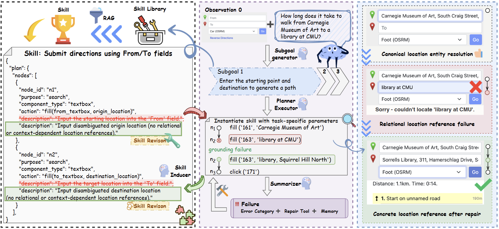

# SkillTracer

**Structural Failure Attribution and Refinement of Agentic Skills in Long-Horizon Web Tasks** · KDD 2026

[Project page](https://liyuuuuy.github.io/SkillTracer/) ·
[Paper](https://doi.org/10.1145/3770855.3817981) ·
[Releases](https://github.com/LiYuuuuy/SkillTracer/releases) ·
[Architecture](docs/architecture.md)

SkillTracer represents reusable browser skills as attributed plan graphs. It
decomposes tasks into subgoals, grounds actions in observed pages, attributes
failures to individual nodes, and repairs the affected structure while retaining
verified progress. Skills, repair experience and component types can then
support later tasks in the same domain.



## What this release includes

- A complete task → subgoal → plan → execution → assessment → repair loop.
- Program-enforced skill reuse, including partial reuse from the skill node
  immediately after the current state.
- Programmatic edge checks against current page observations, supplied as
  evidence to both stages of the Summarizer.
- Versioned working observations, repair memories and domain-scoped learning
  banks, with per-attempt records of produced assets.
- A patched BrowserGym core, 812 WebArena task definitions, local environment
  scripts and offline regression tests.

This is the maintained local implementation. Current prompts and control rules
are documented here. The paper's benchmark scores are not a claim that this
release reproduces those scores without further benchmark evaluation.

## Installation

Use **Python 3.11 or later**. The tested setup is Python 3.12 on Ubuntu 24.04
and WSL 2, with Chromium and Docker Desktop. Docker is needed for WebArena
websites, not for offline tests.

```bash
git clone https://github.com/LiYuuuuy/SkillTracer.git
cd SkillTracer
bash scripts/setup_local.sh
```

The script creates `.venv`, installs pinned dependencies and the bundled
BrowserGym fork, installs Chromium, and creates `.env` from `.env.example`.
Set `OPENROUTER_API_KEY` in `.env` before making model calls. No API key is
required to import the package, display CLI help or run offline tests.

Manual installation:

```bash
python3 -m venv .venv
.venv/bin/python -m pip install -r requirements.lock.txt
.venv/bin/python -m playwright install chromium
cp .env.example .env
```

On Linux, install Chromium's system libraries if needed:

```bash
.venv/bin/python -m playwright install-deps chromium

# Ubuntu 24.04 alternative when sudo is unavailable:
bash scripts/install_browser_deps.sh
```

Keep the bundled `browsergym-core` version `0.10.2+skilltracer.2`. The upstream
package with the same base version lacks this fork's navigation, replacement
input and timeout changes.

## Prepare WebArena

First provision the sites using the
[official WebArena instructions](https://github.com/web-arena-x/webarena/blob/main/environment_docker/README.md).
The launcher below starts existing containers; it does not download images,
create containers or reset data.

| Site | Expected container | Default origin |
| --- | --- | --- |
| Shopping | `shopping` | `http://localhost:7770` |
| Shopping admin | `shopping_admin` | `http://localhost:7780` |
| Reddit | `forum` | `http://localhost:9999` |
| GitLab | `gitlab` | `http://localhost:8023` |
| Map | `openstreetmap-website-web-1`, `openstreetmap-website-db-1` | `http://localhost:3000` |

Run a first shopping task:

```bash
.venv/bin/python scripts/start_webarena.py --sites shopping
.venv/bin/python scripts/check_local.py --sites shopping --browser --llm
.venv/bin/python -m skilltracer --task-id 261 \
  --results-dir .local/example/results --state-dir .local/example/state
```

The health check verifies HTTP availability, browser login and one small model
request. `--llm` makes a paid request. Map routing, geocoding, Wikipedia and the
homepage need their own datasets and services; a responsive frontend alone
does not validate them.

Linux Docker and Windows `docker.exe` through WSL are supported. Set
`DOCKER_CLI` or pass `--docker /path/to/docker.exe` when necessary. Configure
the `WA_*` variables in `.env` if your published ports differ.

## Run tasks

The installed `skilltracer` command and `python -m skilltracer` accept the same
options. Task definitions and prompt resources are bundled with the package.

```bash
# Explicit tasks, executed sequentially.
.venv/bin/python -m skilltracer --task-id 261 277 --max-steps 8

# Inclusive range.
.venv/bin/python -m skilltracer --task-range 260 264

# Reproducible selection of ten single-site tasks.
.venv/bin/python -m skilltracer --site shopping --shuffle --seed 42 --limit 10

# Reuse learning state and skip tasks with an existing result file.
.venv/bin/python -m skilltracer --site shopping \
  --results-dir .local/series/results --state-dir .local/series/state
```

`--max-steps` counts executor rounds, each of which may contain several actions.
Use `--no-skip-existing` to rerun completed tasks, `--headful` to show Chromium,
`--task-dir` for custom task definitions, and `--debug` for full prompts and
additional AXTree snapshots. Use separate roots for independent experiments.
Concurrent workers must use separate state roots; shared-domain bank writes
are not coordinated.

The CLI returns status 1 for runtime errors and continues with remaining tasks.
An evaluator decision of `failure` is a completed experiment, not a runtime
exception. The bundled LLM evaluator is separate from the official WebArena
ground-truth evaluator.

## Configuration

Environment variables override `.env`. Configuration and default output paths
use the current working directory; set `SKILLTRACER_HOME` for another workspace.

| Setting | Default / purpose |
| --- | --- |
| `OPENROUTER_API_KEY` | Your provider key, stored locally |
| `OPENROUTER_BASE_URL` | `https://openrouter.ai/api/v1` |
| `LLM_MODEL` | `openai/gpt-6-luna-pro`; also selectable with `--model` |
| `LLM_REASONING_EFFORT` | `low` for supported reasoning models |
| `BROWSER_TIMEOUT_MS` | `60000` |
| `WA_SHOPPING`, `WA_SHOPPING_ADMIN`, etc. | Site origins from `.env.example` |

All agents and the final evaluator use the selected model by default. Model
availability depends on the provider and your account. OpenAI-compatible
endpoints can also use `OPENAI_API_KEY` and `OPENAI_BASE_URL`; clear the
corresponding `OPENROUTER_*` settings when switching providers.

## Execution, verification and repair

With a matching skill, planner declares `use_skill` and the original
`skill_start_node_id`. Reused node content and internal edges must remain
unchanged. On a mismatch, the runtime appends the skill suffix starting
**before and including** the reported node. Without a match, planner receives
no skill-specific context or output rules.

Executor receives nodes without edges. At reached boundaries the runtime checks
component roles or normalized page text and adds the results to the existing
Summarizer input. Assessment has two stages: six boolean judgments, followed by
localized repair fields only when needed. The program assembles literal repair
text so quotes, backslashes and observation snippets remain valid.

Repairs can change a node's purpose, component type, action or description.
Rollback removes the failed suffix, undoes its exact memory writes and replays
the retained prefix. A replay failure stops execution. Working observations
have stable record IDs and source URLs, so reused browser element IDs do not
overwrite earlier evidence. See the [architecture](docs/architecture.md),
[skill reuse rules](docs/skill-reuse-and-assessment.md),
[edge checks](docs/runtime-edge-checks.md) and
[memory and response behavior](docs/input-memory-response.md).

## Results and learned assets

Results default to `.local/runs/<timestamp>/`; reusable state defaults to
`.local/state/`. Both are isolated by domain. A new domain starts with empty
banks and never imports historical learned assets automatically.

```text
.local/
  state/<domain>/
    skills.txt                 Committed skills and graphs
    memory.txt                 Long-term repair experience, JSONL
    subgoals.txt               Subgoal guidance, JSONL
    components.txt             Purpose/component type registry
    manifest.json              Domain identity and bank format
    provenance.jsonl           References to produced entries
  runs/<timestamp>/<domain>/
    <task_id>.json             Final evaluation and its input
    trajectories/<task_id>.json
    assets/<task_id>/<attempt>/
      manifest.json            Status and per-bank commit flags
      skills.json              Produced skills and induction decisions
      active_memory.json       Versioned page evidence
      short_term_memory.json   Task-local repair memories
      long_term_memory.json    Promoted repair experience
      subgoal_memory.json      Produced subgoal guidance
      components.json          Newly discovered types
      progress.json            Current and verified progress
      events.jsonl             Execution, assessment, repair and learning
      model_calls.jsonl        Model responses and provider errors
```

Attempts are recorded for successful and failed tasks, without requiring
`--debug`. They record production and changes, not copies of loaded banks.
Reruns retain earlier attempts; result and trajectory files identify the
corresponding `assets_dir`.

| Asset | Generation / persistence |
| --- | --- |
| Working observations | Created by `memorize`; retained in the attempt and precisely undone on rollback |
| Short-term memory | Created during repair; retained per subgoal in the attempt |
| Long-term experience | Promoted by repair-memory rules; committed after successful final evaluation |
| Skills | Induced from at least two verified nodes in one subgoal, with budget remaining and at most 20 planning rounds; committed after successful final evaluation |
| Subgoal guidance | Non-Null guidance from completed subgoals; committed after successful final evaluation |
| Component types | Written at eligible subgoal boundaries, including before a later task failure |

A successful task can produce no skill if its induction gates are not met.
Failed tasks can leave inspectable candidates without committing them. Traces
support inspection; automatic execution recovery from them is not implemented.
Bank writes are atomic per file, not a transaction spanning all banks.

```bash
.venv/bin/python -m skilltracer.assets inspect --state-dir .local/state
```

See [asset management](docs/asset-management.md) for formats and migration, and
[learning behavior](docs/learning-behavior.md) for generation and commit rules.

## Development and release checks

```bash
.venv/bin/python -m pip install -e '.[dev]'
.venv/bin/python -m unittest discover -s tests -v
.venv/bin/ruff check skilltracer scripts tests
.venv/bin/ruff format --check skilltracer scripts tests
.venv/bin/python -m pip check

# Build a clean source archive outside the checkout.
.venv/bin/python scripts/package_release.py
```

Offline tests cover graph reuse, node recovery, parsing, both assessment stages,
edge checks, variable/state propagation, rollback, memory versioning and storage
failures. These tests and local browser checks do not establish full WebArena
benchmark performance.

The source packager uses an explicit allowlist. Credentials, browser sessions,
virtual environments, logs, execution results, learned banks, caches and backups
are excluded. Only task definitions and synthetic regression fixtures are
bundled as data. Runtime traces can contain observed page content; review them
separately before sharing.

```text
skilltracer/       Agents, planning, browser integration, learning and runtime
browsergym/core/  Bundled BrowserGym fork
scripts/          Setup, health checks and source packaging
tests/            Offline tests and reference fixtures
docs/             Architecture, storage and behavior contracts
index.html        Research project page
```

## Acknowledgments and citation

SkillTracer builds on [BrowserGym](https://github.com/ServiceNow/BrowserGym) and
[WebArena](https://github.com/web-arena-x/webarena). Their licenses and notices
are retained; see [third-party notices](THIRD_PARTY_NOTICES.md).

If you use this work, please cite:

```bibtex
@inproceedings{li2026skilltracer,
  title     = {SkillTracer: Structural Failure Attribution and Refinement of Agentic Skills in Long-Horizon Web Tasks},
  author    = {Li, Yuyang and Dou, Yiran and Shao, Jie-Jing and Lyu, Yueming and Tsang, Ivor and Yin, Haiyan},
  booktitle = {Proceedings of the 32nd ACM SIGKDD Conference on Knowledge Discovery and Data Mining V.2},
  year      = {2026},
  doi       = {10.1145/3770855.3817981}
}
```
