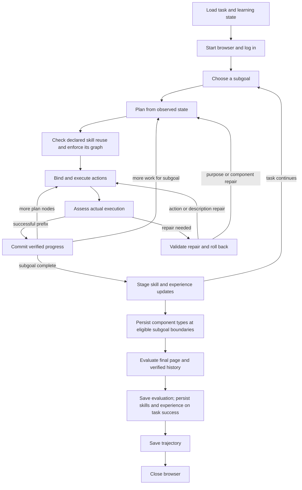

# Runtime architecture

The public entry point is `python -m skilltracer`. Task selection and batching
are handled by `cli.py`; the runtime runs one task at a time within a batch.

## Responsibilities

| Module | Responsibility |
| --- | --- |
| `runtime/workflow.py` | Coordinate task, subgoal and plan loops; own browser cleanup |
| `runtime/state.py` | Explicit task, subgoal, plan and execution-batch state |
| `runtime/execution.py` | Bind actions, execute them in order, retain aligned observations |
| `runtime/repair.py` | Commit verified prefixes, validate repair targets, replay rollback |
| `runtime/learning.py` | Apply original learning gates, stage skills and persist component types |
| `planning/reuse.py` | Validate claimed skill subgraphs and replace nonconforming planner graphs |
| `planning/conditions.py` | Match edge predicates against the current AXTree for assessment evidence |
| `runtime/repositories.py` | Open isolated domain banks, start new domains empty and persist successful tasks |
| `runtime/results.py` | Save evaluations, trajectories and optional diagnostics |
| `runtime/assets.py` | Journal per-attempt skills, memory, components and learning provenance |
| `agents/base.py` | Render prompt resources once and record model responses |
| `storage.py` / `assets.py` | Validate domain paths, inspect banks and archive/migrate legacy state |

The execution budget bounds executor rounds. Additional bounds limit subgoal
and planning retries. Verified actions are retained even when the budget ends
on the last execution round. A browser exception or model exception still
closes the browser through the task's `finally` block.

## Evidence and repair

Every execution batch aligns actions and node IDs with before/after page
observations. Memory actions are evaluated in sequence, so a memory action after
navigation records the resulting page. A `memorize('Null')` action is kept in
the action trace without shifting later memory-node associations.

Working observations have independent record IDs and source URLs, so a reused
browser element ID cannot overwrite another page's evidence. Rollback undoes
exact writes. Field fill clears, enters and verifies the requested value;
infeasibility reasons join ordinary messages in the existing final response.
See [input, memory and response behavior](input-memory-response.md).

Executor binds nodes without receiving edges. The runtime checks incoming edge
predicates at reached node boundaries and appends their results to the existing
assessment trajectory. Both Summarizer stages use this input; edge results add
no independent execution or repair gate. See [programmatic edge checks](runtime-edge-checks.md).

Browser action errors override a model assessment that claims success.
Repairs must reference an existing plan node and supply the argument required
by their tool. Invalid assessments are rejected before rollback; the planner
can retry from the observed page within the remaining budget. Only the dedicated
`InvalidAssessment` exception enters that assessment retry path. `InvalidPlan`
and `InvalidExecution` handle malformed model plans and bindings separately.
Model-service, browser
replay and asset/storage exceptions propagate through cleanup, even when their
Python exception type is `ValueError`.

Purpose and component-type repairs return control to the planner. Action and
description repairs can continue the current plan after replaying its verified
prefix. Failed or unverified actions are not committed to the successful plan.

## Prompt resources

The role prompt resources are under `agents/prompts/`. They define
responsibilities, grounding rules, required context and output formats.
Task descriptions, observations, retrieved skills and memory remain runtime
data. Template substitution happens once, so template-like text in user input
cannot rewrite a later field.

The executor and planner retain their original text protocols for interoperability
with stored skills. Repair responses accept both JSON and line-based summaries.
The execution judge still uses six ordered booleans. Prompt wording has been
shortened, so model outputs and benchmark scores may differ from historical runs.
Offline tests and small live checks do not establish full benchmark equivalence.

Current behavior is specified by the [skill reuse and assessment policies](skill-reuse-and-assessment.md).
Planner signatures and text return values remain unchanged. With a match,
`planner_skill.md` supplies the selected skill and the `use_skill` and
`skill_start_node_id` rules on every planning round. Without a match, the
planner prompt omits all reuse instructions, content and example fields.
The entry identifies the original node immediately after the current state;
replacement starts before that node and includes it, preserving internal edge
conditions and skill completion metadata.
Assessment remains two model stages: six boolean flags, then repair fields only
when required. Literal repair fields are assembled into the existing dictionary
and `Assessment` interfaces. Historical comparisons do not constrain future
behavior unless explicitly requested.
Current [node recovery and retrieval rules](node-identity-and-retrieval.md)
also cover small banks, planner ID collisions, pending repair targets, and
idempotent commits of nodes, actions, observations and rollback state.
The [end-to-end alignment contract](behavior-alignment.md) covers execution
frontiers, failure truncation, immutable memory, promotion and storage round-trips.

## Data and historical files

The published package contains immutable task definitions and no learned seeds.
Each experiment uses a writable state root, separate from source data, with one
subdirectory per task domain. Evaluation records, trajectories and attempts also
sit beneath their domain in the result root. Domain identity is checked before
loading banks; a missing file in an established domain causes an error rather
than silently resetting that bank.

Reusable banks under `--state-dir` and task assets under `--results-dir` have
different lifetimes. Skills and experience are committed after a successful
evaluation; component types are written at eligible subgoal boundaries, even if
the task fails later. Every attempt records assets regardless of its evaluation, with an
independent timestamped directory even when the same task is rerun. Producer
events collect only newly generated or changed skills, long-term experience and
component types. Completed subgoals contribute only their new non-Null guidance.
No initial/current/candidate bank snapshots are serialized into attempts.

`TaskAssets` observes state without changing retrieval or learning rules. It
retains every subgoal's short-term memories, including entries excluded from
prompt context. Agent calls preserve raw responses before parsing; events record
each attempted action and observed result, structured assessments, validated
repair targets and rollback programs. This keeps unverified actions visible
without adding them to the verified trajectory. Python exceptions and keyboard
interrupts pass through the asset context manager before leaving the workflow.

JSON snapshots use atomic replacement per file. The manifest is written last;
the collection of files and the four reusable banks are not a database transaction.
The append-only journals preserve earlier transitions when later snapshots change.
These artifacts support inspection, not automatic task resumption. Full AXTree
debug snapshots remain optional. Ordinary journals retain observed execution
and model responses; full prompts require `--debug` because they can contain
large loaded banks. A domain's `provenance.jsonl` stores committed entity IDs,
content fingerprints and producer paths, without duplicating entity payloads.

The runtime still loads domain banks into memory for the original retrieval and
learning rules. The storage policy changes disk recording, not those algorithms.
Default empty initialization and domain boundaries are intentional changes from
the original mixed banks. Legacy flat banks require explicit migration, with
verified backups and recovery limited to attributed production. See
[asset management](asset-management.md) for the storage contract.

See [learning behavior](learning-behavior.md) for the source audit, generation
thresholds, memory visibility and reference fixtures from the original code.
The [runtime behavior audit](behavior-audit.md) covers rollback, agent inputs,
state references, ordered bank commits and retained defect corrections.
The [state and call audit](state-trace-audit.md) maps original variables and
return values to the refactored runtime and describes full-workflow replay.

Historical launchers, result utilities, unused agents, duplicate datasets,
logs, output directories and OS metadata were moved to the sibling backup
directory. Its `manifest.json` records original paths, sizes and SHA-256 hashes;
`source_before/` preserves the pre-refactor source. None of these files are
part of the source archive or Python distributions.
